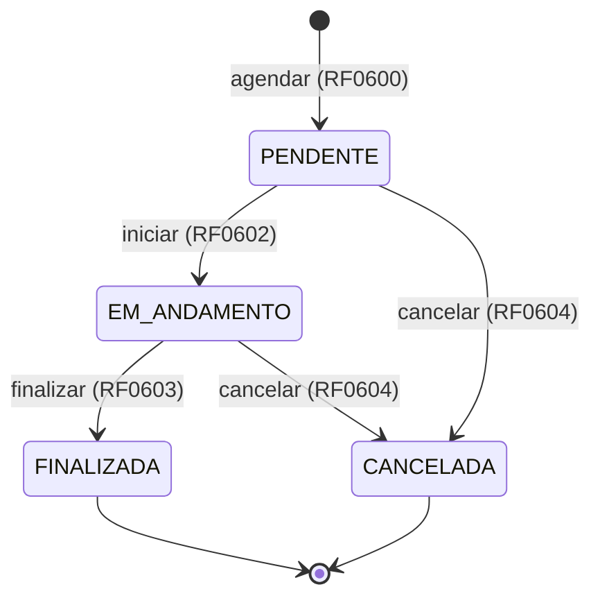

# Aulas

[◀ Índice](README.md)

## Regras de negócio

| ID | Regra |
| --- | --- |
| RG0600 | A data/hora de fim deve ser maior que a data/hora de início. |
| RG0601 | A turma deve existir e estar com status `ATIVA` no momento do agendamento (ver [RG0406](04-turmas.md)). |
| RG0602 | Não deve permitir sobreposição de horário entre aulas da mesma turma, desconsiderando aulas `CANCELADA`. |
| RG0603 | Não deve permitir sobreposição de horário para o mesmo professor, considerando todas as turmas sob sua responsabilidade. |
| RG0604 | Toda aula é criada com status `PENDENTE`. O status não é aceito no payload de agendamento. |
| RG0605 | Transições válidas: `PENDENTE` → `EM_ANDAMENTO` ou `CANCELADA`; `EM_ANDAMENTO` → `FINALIZADA` ou `CANCELADA`. `FINALIZADA` e `CANCELADA` são estados finais. Qualquer outra transição é rejeitada. |
| RG0606 | Não deve permitir mais de uma aula `EM_ANDAMENTO` por turma simultaneamente. |
| RG0607 | Data/hora de início e fim só podem ser editadas enquanto a aula estiver `PENDENTE`. |
| RG0608 | Não deve permitir agendar aula com data/hora de início no passado. |
| RG0609 | A soma da duração das aulas `FINALIZADA` não pode exceder a carga horária da turma (ver [RG0407](04-turmas.md)). |
| RG0610 | A aula não deve ser excluída fisicamente; o cancelamento substitui a exclusão. |
| RG0611 | A duração de uma aula não pode exceder 24 horas. |

### Máquina de estados (RG0605)

Versão comentada, com as regras de cada estado, em [10-diagramas-de-estado.md](10-diagramas-de-estado.md#aula-rg0605).

## Requisitos funcionais

| ID | Requisito |
| --- | --- |
| RF0600 | Deve permitir agendar aula para uma turma. |
| RF0601 | Deve permitir editar a aula (data/hora de início e fim — ver RG0607). |
| RF0602 | Deve permitir iniciar a aula (`PENDENTE` → `EM_ANDAMENTO`). |
| RF0603 | Deve permitir finalizar a aula (`EM_ANDAMENTO` → `FINALIZADA`). |
| RF0604 | Deve permitir cancelar a aula. |
| RF0605 | Deve permitir listar as aulas filtrando por turma, professor, status e período (data de início/fim), com paginação. |
| RF0606 | Deve permitir buscar aula por id. |
| RF0607 | Deve permitir obter a agenda de um professor em um período. |

## Relacionados

- [Turmas](04-turmas.md) — RG0405 (inativação cancela aulas pendentes), RG0407 e RG0408 (carga horária realizada).
- [Professores](02-professores.md) — RG0603 e RF0607.
- [Modelo de dados](00-modelo-de-dados.md) — pontos de atenção 4 e 5: motivo de cancelamento e controle de presença.
- [Diagramas de fluxo](11-diagramas-de-fluxo.md) — agendamento (RF0600) e finalização com conclusão da turma (RF0603).
- [Diagrama do banco](09-diagrama-banco.md) — constraint `EXCLUDE` que garante RG0602 sob concorrência.
- [Mapa de endpoints](07-endpoints.md#aulas)
