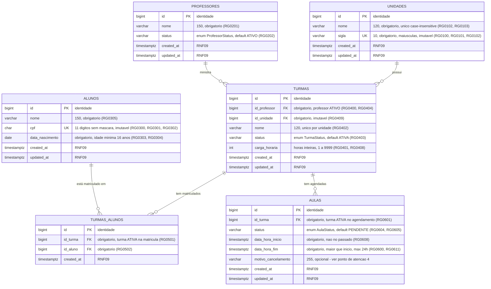

# Diagrama do banco de dados

[◀ Índice](README.md)

## Modelo entidade-relacionamento

A chave única composta de `TURMAS_ALUNOS (id_turma, id_aluno)` e os índices únicos que ignoram caixa não
aparecem na notação ER acima — estão na seção [Restrições e índices esperados](#restrições-e-índices-esperados-no-banco).

## Cardinalidades

| Relacionamento | Cardinalidade | Observação |
| --- | --- | --- |
| Unidade → Turmas | 1 : N | Unidade obrigatória na turma; não pode ser trocada ([RG0409](04-turmas.md)) nem excluída com turmas ([RG0104](01-unidades.md)). |
| Professor → Turmas | 1 : N | Um professor por turma; turma `ATIVA` bloqueia a inativação dele ([RG0200](02-professores.md)). |
| Turma ↔ Aluno | N : N | Resolvida por `TURMAS_ALUNOS`, com unicidade do par ([RG0500](05-matriculas.md)). |
| Turma → Aulas | 1 : N | Aulas não podem se sobrepor na mesma turma ([RG0602](06-aulas.md)). |
| Professor → Aulas | 1 : N (indireta) | Derivada via `TURMAS.id_professor`; sustenta [RG0603](06-aulas.md) e [RF0607](06-aulas.md). |

## Restrições e índices esperados no banco

Reforço das regras na camada de dados ([RNF07](08-requisitos-nao-funcionais.md)). A criação do schema é
responsabilidade das migrações do projeto — esta seção descreve apenas o que deve existir.

| Tabela | Restrição / índice | Regra |
| --- | --- | --- |
| `unidades` | unicidade de `sigla` (persistida em maiúsculas) | [RG0100](01-unidades.md), [RG0102](01-unidades.md) |
| `unidades` | unicidade de `nome` ignorando caixa (índice funcional) | [RG0103](01-unidades.md) |
| `professores` | domínio de `status` restrito a `ATIVO`/`INATIVO`, default `ATIVO` | [RG0202](02-professores.md) |
| `professores` | índice de busca por `nome` ignorando caixa | [RF0203](02-professores.md) |
| `alunos` | unicidade de `cpf` | [RG0300](03-alunos.md) |
| `alunos` | formato de `cpf` restrito a 11 dígitos | [RG0301](03-alunos.md) |
| `alunos` | índice de busca por `nome` ignorando caixa | [RF0302](03-alunos.md) |
| `turmas` | FK obrigatória para `professores` e `unidades` | [RG0400](04-turmas.md), [RG0409](04-turmas.md) |
| `turmas` | unicidade de `nome` por `id_unidade`, ignorando caixa | [RG0402](04-turmas.md) |
| `turmas` | domínio de `status`, default `ATIVA`; `carga_horaria` entre 1 e 9999 | [RG0401](04-turmas.md), [RG0403](04-turmas.md) |
| `turmas` | índice por `(id_professor, status)` | [RG0200](02-professores.md), [RF0403](04-turmas.md) |
| `turmas_alunos` | unicidade do par `(id_turma, id_aluno)` | [RG0500](05-matriculas.md) |
| `turmas_alunos` | índice por `id_aluno` | [RF0304](03-alunos.md) |
| `aulas` | domínio de `status`, default `PENDENTE` | [RG0604](06-aulas.md) |
| `aulas` | `data_hora_fim` maior que `data_hora_inicio` e duração máxima de 24h | [RG0600](06-aulas.md), [RG0611](06-aulas.md) |
| `aulas` | índice por `(id_turma, data_hora_inicio, data_hora_fim)` | [RG0602](06-aulas.md), [RF0605](06-aulas.md) |
| `aulas` | restrição de exclusão por período (`EXCLUDE` com `btree_gist`), desconsiderando `CANCELADA` | [RG0602](06-aulas.md) |

### Notas de implementação

- **Regras temporais não ficam em `CHECK`.** `data_nascimento` no passado ([RG0303](03-alunos.md)), idade mínima
  ([RG0304](03-alunos.md)) e início no futuro ([RG0608](06-aulas.md)) dependem da data corrente e, portanto, são
  validadas na aplicação — um `CHECK` com `now()`/`CURRENT_DATE` quebra em dump/restore.
- **Enums como `VARCHAR` + `CHECK`**, não `CREATE TYPE`: mapeia direto para `@Enumerated(EnumType.STRING)` e
  dispensa migração de tipo para incluir um valor novo.
- **A constraint `EXCLUDE`** cobre [RG0602](06-aulas.md) sob concorrência; a verificação equivalente no service
  continua existindo para devolver `409` com o código da regra ([RNF05](08-requisitos-nao-funcionais.md)).
  Para [RG0603](06-aulas.md) (sobreposição por professor) não há constraint direta, pois o professor está em
  `turmas` — a validação é no service, com `SELECT ... FOR UPDATE` na turma.
- **Exclusões bloqueadas** ([RG0104](01-unidades.md), [RG0306](03-alunos.md)) são garantidas pelas próprias FKs,
  que por padrão são `ON DELETE NO ACTION`.
