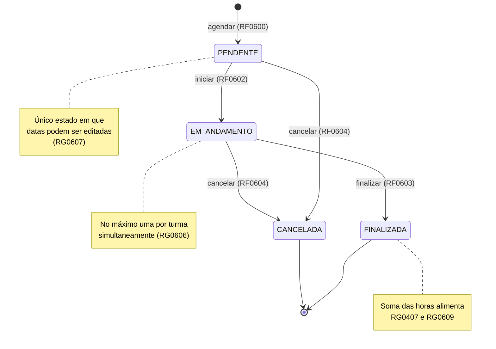
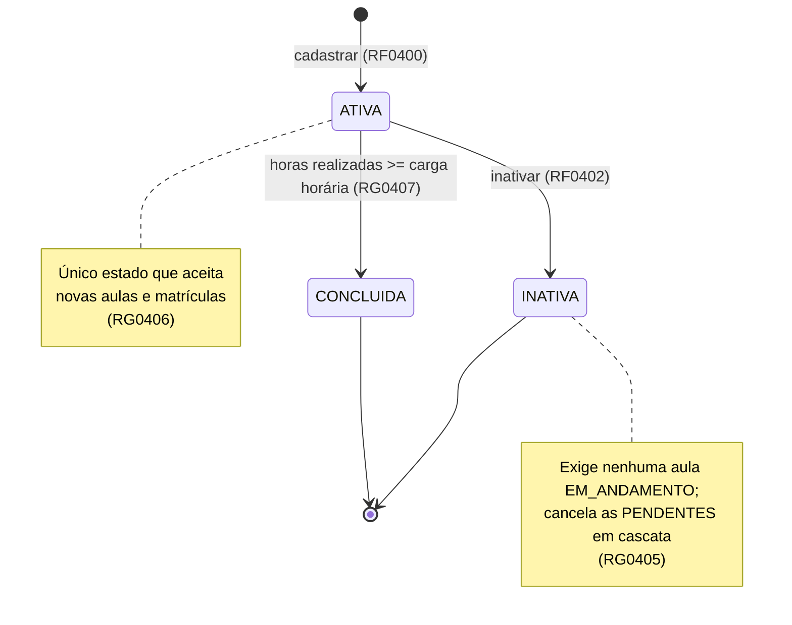
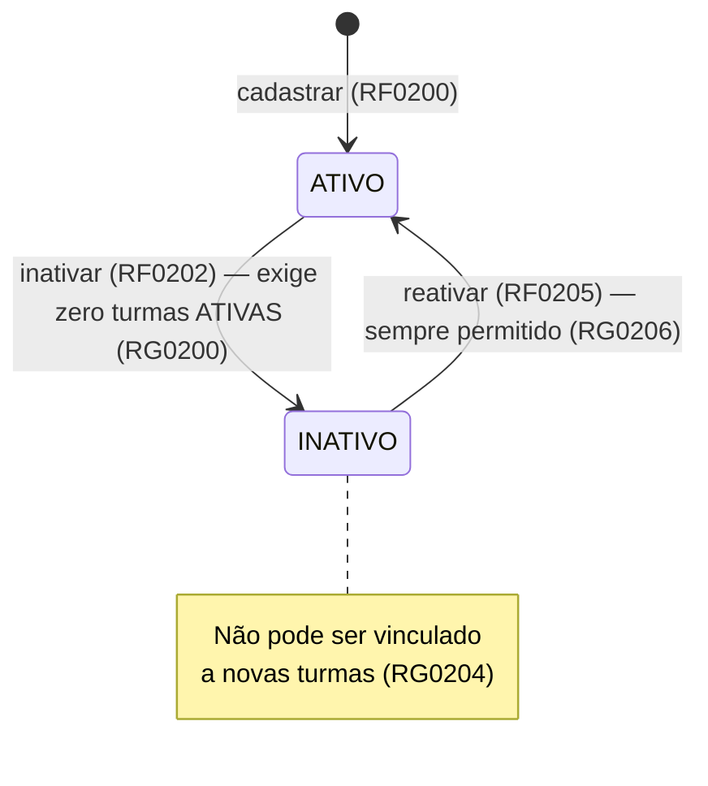
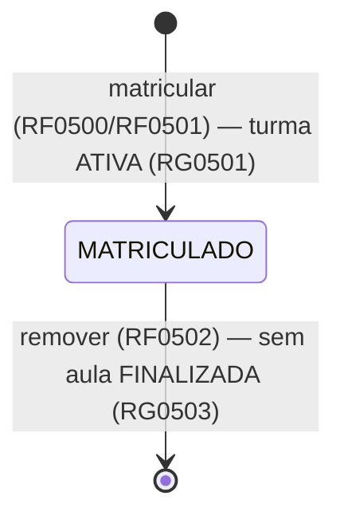

# Diagramas de estado

[◀ Índice](README.md)

Todas as transições abaixo são as únicas válidas: qualquer outra tentativa é rejeitada com `409`
e o código da regra ([RNF04, RNF05](08-requisitos-nao-funcionais.md)).

## Aula ([RG0605](06-aulas.md))

Estados finais: `FINALIZADA` e `CANCELADA`. Não existe exclusão física de aula ([RG0610](06-aulas.md)).

## Turma ([RG0403](04-turmas.md), [RG0405](04-turmas.md), [RG0407](04-turmas.md))

> **Em aberto:** a reativação de turma (`INATIVA` → `ATIVA`) não foi especificada. Se for necessária, criar
> RF0406/RG0410 no modelo da [reativação de professor](02-professores.md).

## Professor ([RG0200](02-professores.md), [RG0202](02-professores.md), [RG0206](02-professores.md))

Inativar quem já está `INATIVO` e reativar quem já está `ATIVO` são operações idempotentes
([RG0205](02-professores.md)) — não são transições, retornam sucesso sem alterar o registro.

## Matrícula

Não possui coluna de status: existe ou não existe. A remoção é física e condicionada a
[RG0503](05-matriculas.md) (turma sem nenhuma aula `FINALIZADA`).

