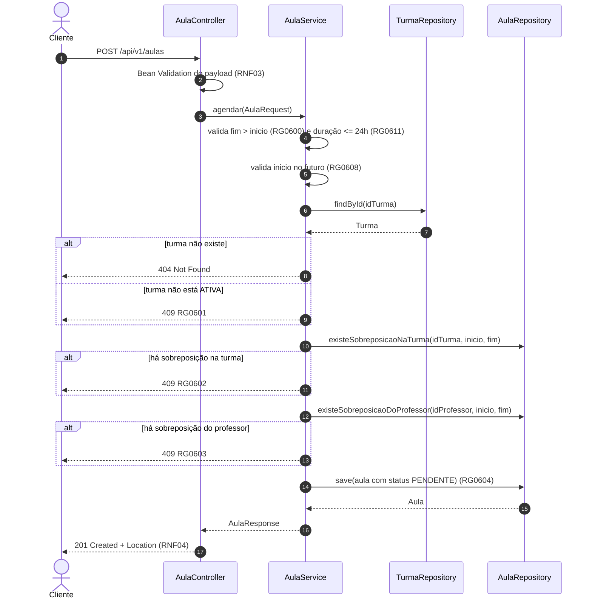
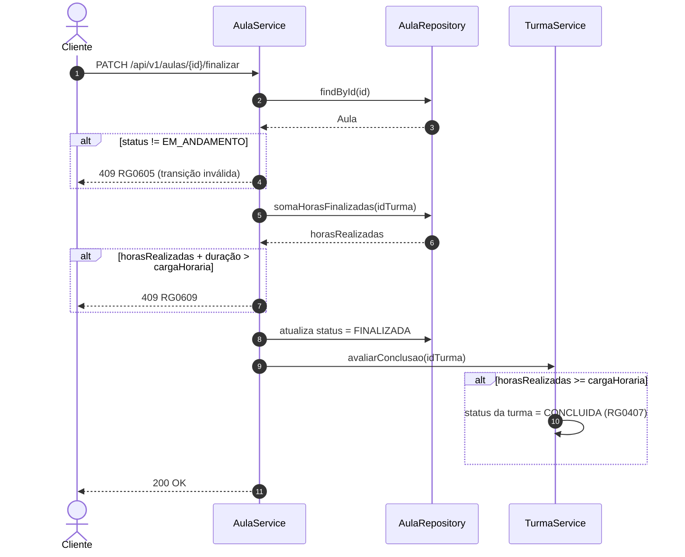
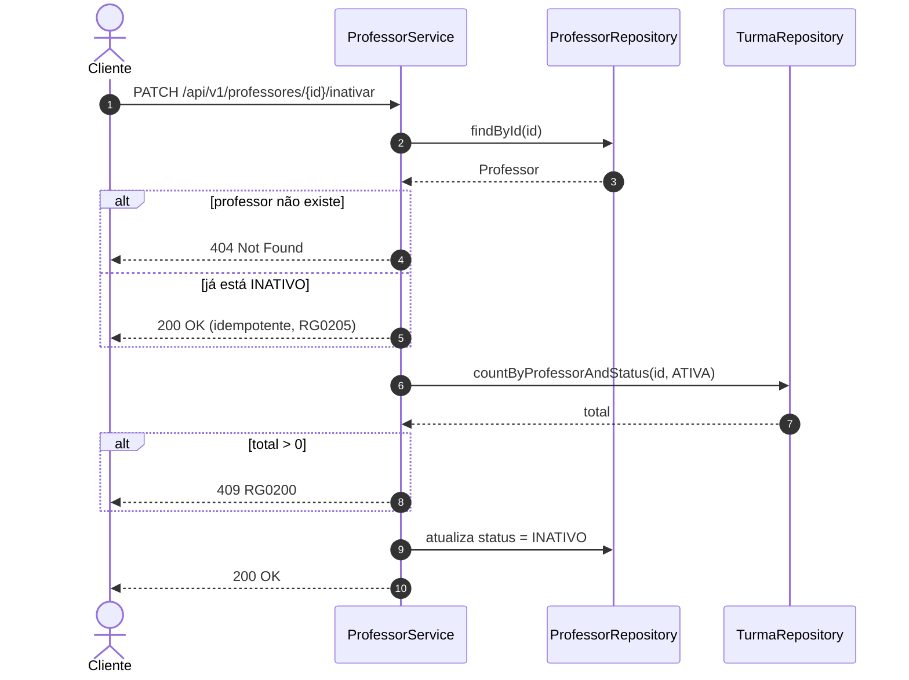
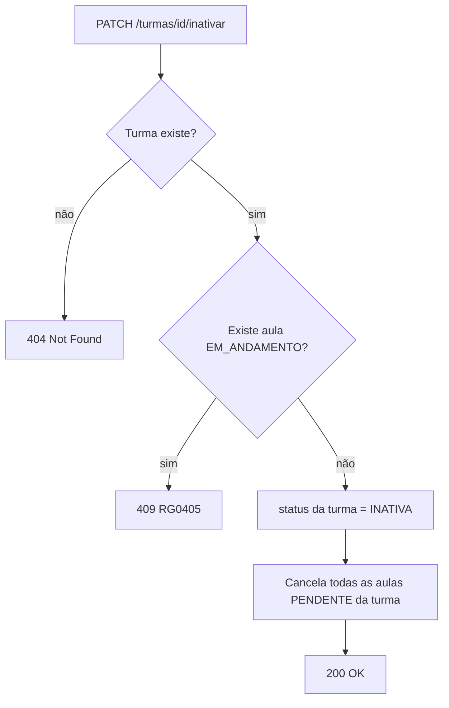
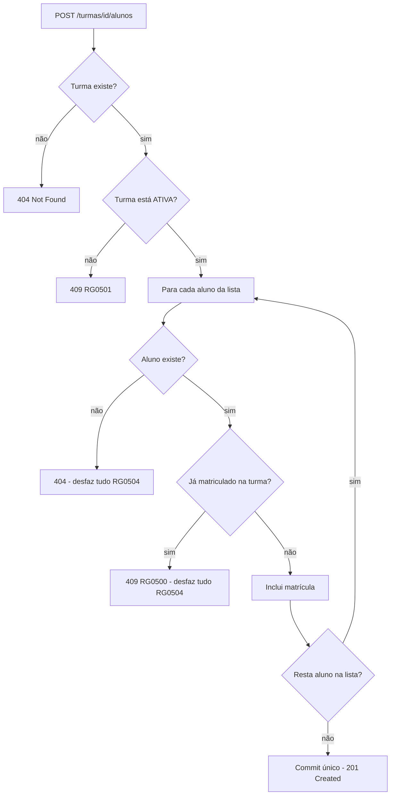
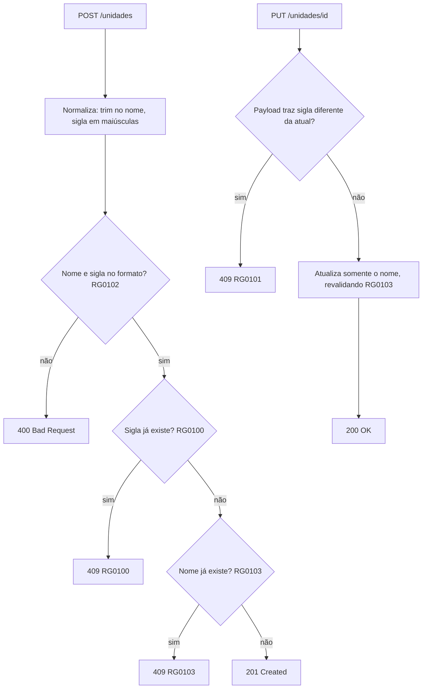

# Diagramas de fluxo das operações

[◀ Índice](README.md)

Fluxos das operações que concentram regras de negócio. A ordem de validação importa: valida-se primeiro o que
custa menos (formato, existência) e depois o que exige consulta ([RNF03](08-requisitos-nao-funcionais.md)).

## Agendar aula ([RF0600](06-aulas.md))

## Finalizar aula e conclusão automática da turma ([RF0603](06-aulas.md), [RG0407](04-turmas.md))

A mesma transação cobre a aula e a turma ([RNF08](08-requisitos-nao-funcionais.md)): se a conclusão falhar, a
finalização da aula não é efetivada.

## Inativar professor ([RF0202](02-professores.md), [RG0200](02-professores.md))

## Inativar turma com cascata nas aulas ([RF0402](04-turmas.md), [RG0405](04-turmas.md))

## Matricular alunos em lote ([RF0501](05-matriculas.md), [RG0504](05-matriculas.md))

## Cadastrar unidade ([RF0100](01-unidades.md)) e editar ([RF0101](01-unidades.md))

