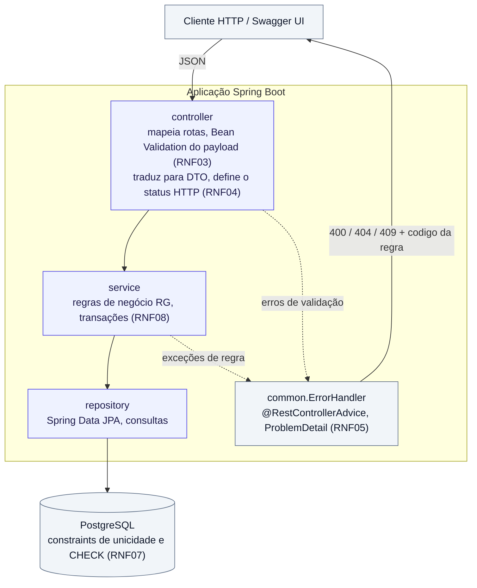
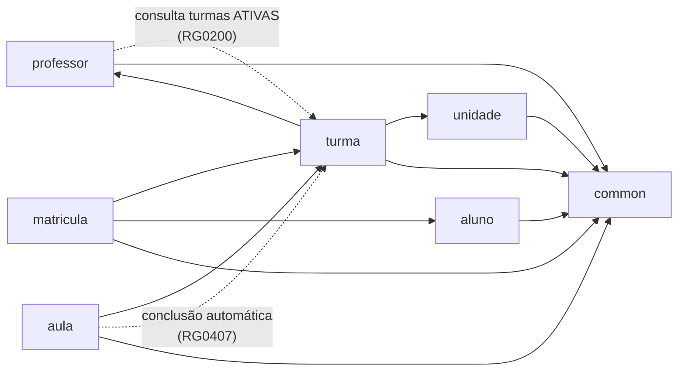
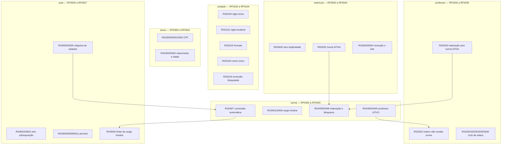

# Arquitetura

[◀ Índice](README.md)

## Camadas ([RNF02](08-requisitos-nao-funcionais.md))

Regras do desenho:

- O `controller` nunca chama `repository`, e o `service` nunca conhece tipos de HTTP.
- Entidades JPA não cruzam a fronteira do `controller`: entrada e saída sempre por DTOs
  ([RNF02](08-requisitos-nao-funcionais.md)).
- Validação de formato fica nas anotações do DTO; validação de regra de negócio fica no `service`
  ([RNF03](08-requisitos-nao-funcionais.md)). O banco repete as unicidades como rede de segurança
  ([RNF07](08-requisitos-nao-funcionais.md)).

## Módulos e dependências

As duas setas tracejadas são as únicas dependências de volta: `professor` precisa consultar turmas para
[RG0200](02-professores.md) e `aula` precisa atualizar a turma para [RG0407](04-turmas.md). Ambas passam pelo
*service* da turma — nunca pelo repositório dele — para não duplicar regra.

Estrutura de pacotes correspondente em
[08-requisitos-nao-funcionais.md](08-requisitos-nao-funcionais.md#estrutura-de-pacotes-sugerida-rnf02).

## Mapa de regras por módulo

